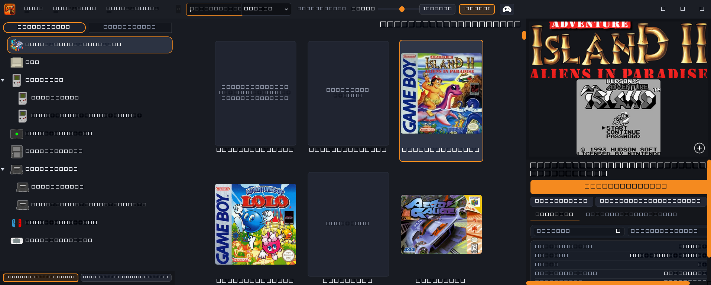
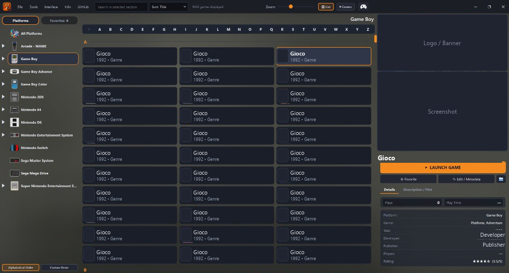
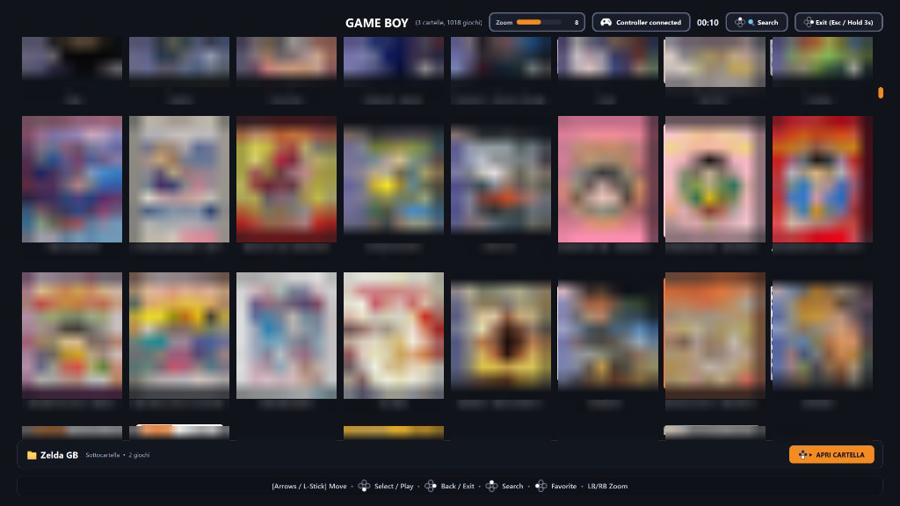

<div align="center">
  
  <h1>EasyLauncher</h1>
  <p><strong>Open Source, 100% Portable &amp; Effortless Retro Game &amp; Emulator Frontend for Windows</strong></p>
  <p>
    <a href="https://github.com/matteo0984/EasyLauncher/releases/latest">
      
    </a>
    
    
    
  </p>
  <p><strong>English</strong> · <a href="README_IT.md">🇮🇹 Italiano</a></p>
</div>

---

## What is EasyLauncher?

**EasyLauncher** is a **free, open-source** desktop frontend ([MIT License](LICENSE)) designed around two core ideas: **instant simplicity and total versatility**.  
Whether you want to organize a small folder of favorite classics or thousands of multi-console ROMs, you can set everything up in just a few clicks without editing INI files or writing scripts — and carry your entire library anywhere on a USB drive or external SSD.

<div align="center">
  
</div>

---

## Key Features &amp; Strengths

- **Zero-Friction Setup:** Pick a console name and point to your ROM folder — **file extensions and platform icons are filled in automatically**. Ready to play in 5 quick steps.
- **100% Portable (No Installation):** Everything lives inside a single folder (`data/`, `roms/`, `emulators/`, `media/`). Zero Windows Registry clutter; copy it to a USB stick or another PC anytime.
- **Dual View — ⊞ Covers &amp; ☰ 3-Column List:** Switch in one click between the Cover Grid and a **3-column List View** grouped alphabetically with a quick-jump **`# A–Z` alphabet bar** and independent zoom levels for each mode.
- **Multi-Source Scraper (Works Without API Keys):** Automatically fetches titles, descriptions, genres, release years, boxart, logos, and **1–3 distinct extra gameplay screenshots** (deduplicated via SHA-256 hash) using free sources (*Libretro*, *LaunchBox*, *ArcadeDB*, *Steam*, *GOG*, *Wikipedia*, *Wikidata*), plus optional *IGDB*, *ScreenScraper*, *TheGamesDB*, and *SteamGridDB* support.
- **Fullscreen / Gamepad Mode (`F11`):** Couch-friendly interface fully controllable with an **Xbox/XInput controller** or keyboard, including a built-in virtual keyboard for search and favorite folder management.
- **Deep Visual Customization:** Dark &amp; Light themes, saveable appearance profiles, dynamic blurred backdrops per panel, custom accent colors, independent corner rounding for covers/logos/screenshots, and lockable resizable panels.
- **5 Built-in Languages:** *English* (default on first launch), *Italiano*, *Français*, *Español*, and *Deutsch*, with automatic persistence.
- **Built-in Backup &amp; Restore:** Archive and restore your database, settings, and downloaded media in one click.

<div align="center">
  
  
</div>

---

## Download Pre-Built App (Windows Portable)

Don't want to install Python? Grab the ready-to-run build:

1. Go to the **[Releases](https://github.com/matteo0984/EasyLauncher/releases)** page.
2. Download **`EasyLauncher-v1.0-win64-portable.zip`**.
3. Extract the folder anywhere (including a USB drive).
4. Run **`EasyLauncher.exe`**.

> **Tip:** Inside the app, open **Info → User Guide…** (`docs/manual.html`) for the full illustrated manual.

---

## Run from Source or Build

### Requirements
- **Python 3.11+** (Windows 10/11)

### Run from source
```bash
git clone https://github.com/matteo0984/EasyLauncher.git
cd EasyLauncher
python -m venv .venv
.venv\Scripts\activate
pip install -r requirements.txt
python main.py
```

### Build portable `.exe`
Run [`build.bat`](build.bat) or:
```bash
pyinstaller --noconfirm --onedir --windowed --icon=icons\app_icon.ico --name EasyLauncher main.py
```

---

## Project Structure

| File / Folder | Description |
| :--- | :--- |
| `main.py` | Application entry point |
| `ui_main.py` | 3-column main window, List/Cover views, menus, and themes |
| `bigscreen.py` | Fullscreen mode with native XInput / Gamepad navigation |
| `dialogs.py` | Platform, Emulator, Scraper, Appearance, and Backup dialogs |
| `scraper.py` | Multi-source scraper engine &amp; SHA-256 deduplicated media downloader |
| `database.py` | SQLite (`library.db`) and JSON config (`config.json`) layer |
| `launcher.py` | Emulator launching &amp; playtime tracking |
| `i18n.py` | Full 5-language localization (`en`, `it`, `fr`, `es`, `de`) |
| `docs/` | Illustrated manual (`manual.html`) and API setup guides |
| `icons/` | App icon and platform icons |

---

## License &amp; Open Source Notices

- **EasyLauncher Source Code:** Released under the **[MIT License](LICENSE)**.
- **Third-Party Libraries &amp; Icon Attributions:** See **[THIRD_PARTY_LICENSES.md](THIRD_PARTY_LICENSES.md)** for full open-source notices (PySide6/Qt 6, Requests, PyInstaller, metadata sources, and platform icon attributions).
