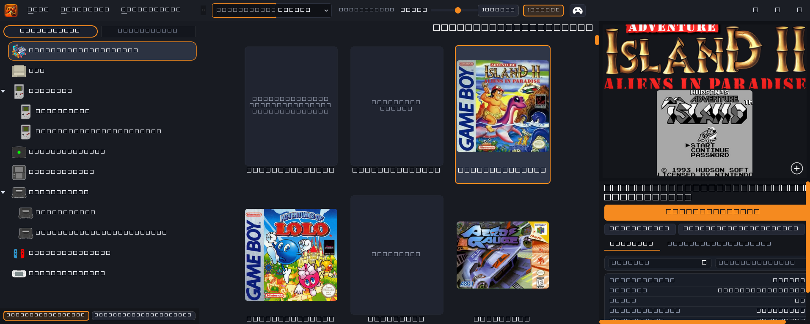
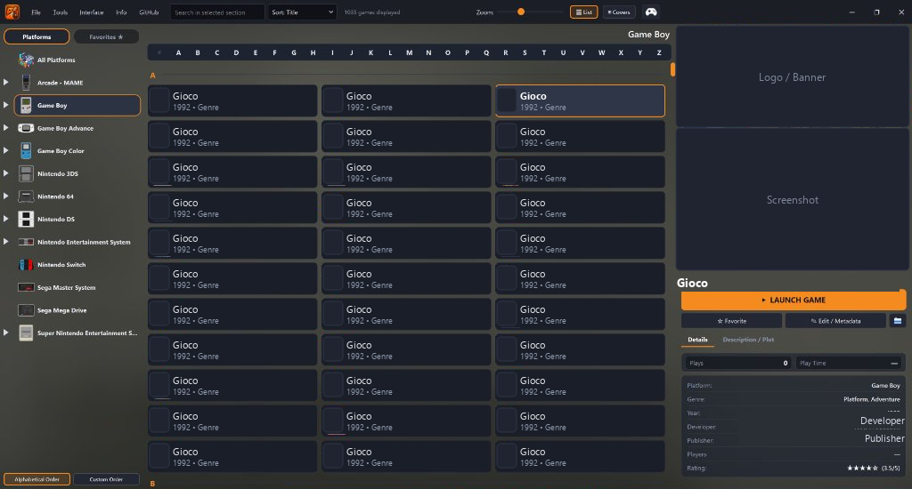
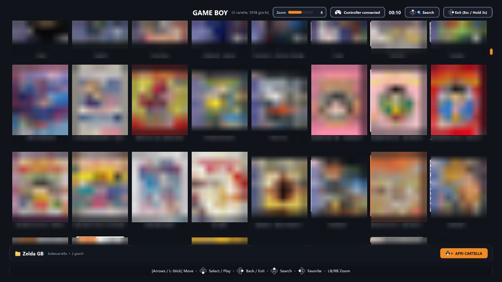

<div align="center">
  
  <h1>EasyLauncher</h1>
  <p><strong>Frontend Open Source, 100% Portable e Intuitivo per Emulatori e Collezioni Retro</strong></p>
  <p>
    <a href="https://github.com/matteo0984/EasyLauncher/releases/latest">
      
    </a>
    
    
    
  </p>
  <p><a href="README.md">🇬🇧 English</a> · <strong>🇮🇹 Italiano</strong></p>
</div>

---

## Cos'è EasyLauncher?

**EasyLauncher** è un frontend desktop **open source** (rilasciato sotto licenza [MIT](LICENSE)) progettato con un obiettivo preciso: **unire semplicità immediata e massima versatilità**.  
Che tu voglia organizzare una piccola cartella di giochi preferiti o migliaia di ROM multi-piattaforma, puoi configurare tutto in pochi clic senza scrivere file INI o script complicati — e portare l'intera libreria sempre con te su chiavetta USB o hard disk esterno.

<div align="center">
  
</div>

---

## Punti di Forza e Peculiarità

- **Semplicità Immediata:** scegli il nome della console e la cartella delle ROM; **estensioni dei file e icona vengono compilate in automatico**. In 5 passaggi sei già pronto a giocare.
- **100% Portable (Zero Installazione):** tutto vive nella cartella del programma (`data/`, `roms/`, `emulators/`, `media/`). Nessuna chiave nel registro di sistema, facile da copiare o spostare su un altro PC.
- **Doppia Vista — ⊞ Copertine e ☰ Lista a 3 Colonne:** alterna in un clic tra la griglia copertine e una vista lista a **3 colonne** raggruppata per lettera iniziale con **barra alfabetica rapida (`# A–Z`)** in alto e zoom indipendente per ciascuna vista.
- **Scraper Multi-Fonte (anche senza API Key):** scarica automaticamente titoli, descrizioni, generi, anni, copertine, loghi e **1–3 screenshot extra tutti diversi** (deduplicazione con hash SHA-256) usando fonti gratuite (*Libretro*, *LaunchBox*, *ArcadeDB*, *Steam*, *GOG*, *Wikipedia*, *Wikidata*) più il supporto opzionale per *IGDB*, *ScreenScraper*, *TheGamesDB* e *SteamGridDB*.
- **Modalità Schermo Intero / Controller (`F11`):** interfaccia da divano controllabile interamente con **gamepad Xbox/XInput** o tastiera, completa di tastiera virtuale per la ricerca e gestione delle cartelle preferiti.
- **Personalizzazione Profonda:** Tema Scuro / Chiaro, profili aspetto salvabili, sfondi sfocati dinamici per colonna, colore d'accento personalizzabile, angoli arrotondati regolabili separatamente per copertine/loghi/screenshot e pannelli ridimensionabili con blocco.
- **Multilingua (5 Lingue):** *English* (predefinito al primo avvio), *Italiano*, *Français*, *Español* e *Deutsch*, con salvataggio automatico della preferenza.
- **Backup e Ripristino Integrati:** esporta e ripristina database, configurazioni e media in un unico archivio.

<div align="center">
  
  
</div>

---

## Scaricare il Programma Già Compilato (Windows)

Non vuoi installare Python? Scarica la versione già pronta all'uso:

1. Vai nella sezione **[Releases](https://github.com/matteo0984/EasyLauncher/releases)** di questa pagina GitHub.
2. Scarica l'archivio **`EasyLauncher-v1.0-win64-portable.zip`**.
3. Estrai la cartella dove preferisci (anche su una chiavetta USB).
4. Avvia **`EasyLauncher.exe`**.

> **Nota:** All'interno dell'app troverai il manuale illustrato completo in **Info → Guida…** (`docs/manual.html`).

---

## Avviare dai Sorgenti o Compilare

### Requisiti
- **Python 3.11+** (Windows 10/11)

### Esecuzione da codice sorgente
```bash
git clone https://github.com/matteo0984/EasyLauncher.git
cd EasyLauncher
python -m venv .venv
.venv\Scripts\activate
pip install -r requirements.txt
python main.py
```

### Compilazione eseguibile portable (`.exe`)
Puoi usare direttamente lo script [`build.bat`](build.bat) oppure:
```bash
pyinstaller --noconfirm --onedir --windowed --icon=icons\app_icon.ico --name EasyLauncher main.py
```

---

## Struttura del Progetto

| File / Cartella | Descrizione |
| :--- | :--- |
| `main.py` | Entry point dell'applicazione |
| `ui_main.py` | Interfaccia principale a 3 colonne, vista Lista/Copertine, menu e temi |
| `bigscreen.py` | Modalità Schermo Intero con supporto nativo XInput / Controller |
| `dialogs.py` | Finestre di gestione Piattaforme, Emulatori, Scraping, Aspetto e Backup |
| `scraper.py` | Motore di scraping multi-fonte e download media deduplicato |
| `database.py` | Gestione SQLite (`library.db`) e configurazione JSON (`config.json`) |
| `launcher.py` | Avvio emulatori e tracciamento tempo di gioco |
| `i18n.py` | Traduzioni complete in 5 lingue (`en`, `it`, `fr`, `es`, `de`) |
| `docs/` | Manuale completo illustrato (`manual.html`) e guide API |
| `icons/` | Icona app e set icone piattaforme |

---

## Licenza e Dichiarazioni Open Source

- **Codice sorgente EasyLauncher:** rilasciato sotto licenza **[MIT License](LICENSE)**.
- **Dichiarazioni di terze parti e icone:** consulta **[THIRD_PARTY_LICENSES.md](THIRD_PARTY_LICENSES.md)** per l'elenco completo delle librerie open source utilizzate (PySide6/Qt 6, Requests, PyInstaller, ecc.), delle fonti metadati e delle attribuzioni per le icone.
